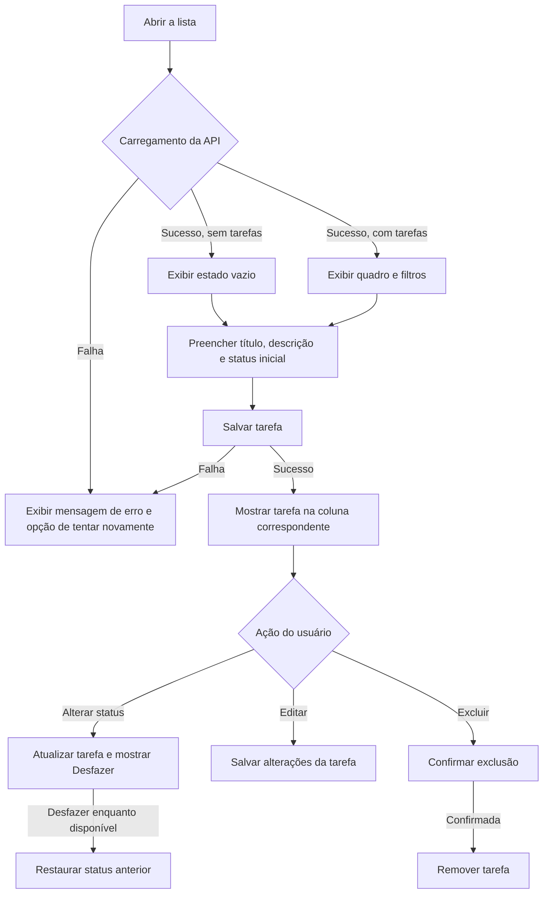

# Fluxo de uso e interface

## Jornada principal

## Organização da tela

1. **Cabeçalho:** identifica a área de tarefas.
2. **Formulário “Nova tarefa”:** recebe título, descrição e status inicial.
3. **Resumo e filtros:** mostram a contagem em andamento e permitem selecionar
   Todas, Pendente, Em andamento ou Concluída.
4. **Quadro:** apresenta uma coluna por status e cartões com os dados e ações
   da tarefa.
5. **Notificações:** apresentam mensagens de sucesso ou erro; após uma mudança
   de status bem-sucedida, a notificação inclui **Desfazer** por seis
   segundos.

## Estados da interface

- **Carregando:** sinaliza a busca inicial ou uma operação em andamento.
- **Vazio:** explica que não há tarefas na lista ou no filtro atual.
- **Sucesso:** confirma uma operação; a notificação temporária desaparece
  automaticamente.
- **Erro:** apresenta a falha retornada ou detectada na comunicação com a API.
- **Confirmação:** a exclusão exige confirmação antes de remover a tarefa.
- **Filtro sem resultados:** mantém os filtros visíveis e informa que não há
  tarefas para o critério selecionado.

## Responsividade e acessibilidade

- O quadro é organizado em três colunas em telas largas e em uma coluna em
  telas de até 600 px.
- A interface é navegável por controles de formulário e botões identificados.
- As mensagens de erro usam alerta acessível; mensagens de sucesso usam uma
  região de status.
- A preferência do sistema por movimento reduzido é considerada nos estilos.
- O fluxo de teclado, contraste em diferentes temas e compatibilidade com
  leitores de tela devem fazer parte da validação de aceite do cliente; não há
  relatório formal de auditoria de acessibilidade.

## Limite da ação de desfazer

O desfazer é oferecido somente para a alteração mais recente de status,
enquanto a notificação de sucesso correspondente estiver visível (seis
segundos). Ele envia uma nova atualização à API para restaurar o status
anterior; não é um histórico persistente de ações e não desfaz criação,
edição ou exclusão.
