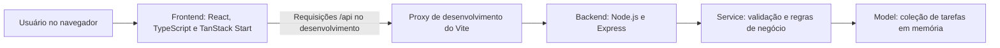

# Arquitetura da solução

## Visão geral

O projeto reúne uma aplicação web e uma API HTTP em diretórios separados:

O frontend usa `/api/tarefas` para listar e alterar tarefas. Durante o
desenvolvimento, o Vite encaminha essas chamadas para o backend em
`http://127.0.0.1:3001`. Esse proxy é uma configuração de desenvolvimento; a
topologia de produção ainda precisa ser definida.

## Componentes e responsabilidades

### Frontend

- **React e TypeScript:** interface e tipagem do domínio de tarefas.
- **TanStack Start/Router e Vite:** execução e build da aplicação web.
- **`frontend/src/routes/index.tsx`:** página principal, formulário, quadro,
  filtros, estados de operação e desfazer.
- **`frontend/src/components/task-row.tsx`:** cartão e ações de uma tarefa.
- **`frontend/src/lib/tasks-api.ts`:** chamadas HTTP e validação básica dos
  dados recebidos.
- **`frontend/src/lib/tasks.ts`:** tipos e transformações locais de tarefas.

### Backend

- **Node.js e Express:** servidor HTTP e interpretação de JSON.
- **Router:** mapeia URLs e métodos HTTP para o controller.
- **Controller:** traduz operações da API em respostas HTTP.
- **Service:** valida entradas e aplica as regras de negócio.
- **Model:** cria, consulta, atualiza e exclui tarefas em memória.
- **Configuração:** define a porta do servidor pela variável `PORT` (padrão
  `3001`).

## Dados e limites de implantação

O model atual mantém uma coleção em memória, inicializada com tarefas de
exemplo. Não há banco de dados nem recuperação após reinício do processo. O
servidor Express inicia ligado a `127.0.0.1`, apropriado para execução local;
para acesso remoto, será necessário definir hospedagem, interface de rede,
proxy/reverse proxy e controles de segurança adequados.

O projeto não implementa autenticação ou autorização. Portanto, não se deve
assumir isolamento de dados ou segurança multiusuário.

## Dependências principais

- Frontend: React, TypeScript, TanStack Start/Router, Vite e Tailwind CSS.
- Backend: Node.js e Express.
- Testes: Vitest e Testing Library no frontend; `node:test` no backend.

As versões detalhadas estão nos arquivos `package.json` e lockfiles de cada
aplicação. O projeto não declara uma versão mínima de Node.js nos manifests;
ela deve ser acordada e fixada para uma implantação reproduzível.
